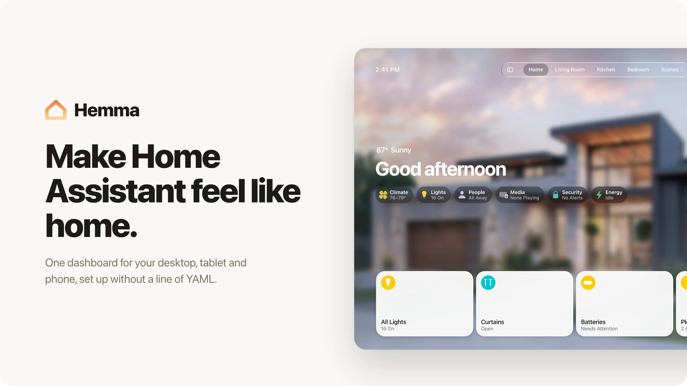
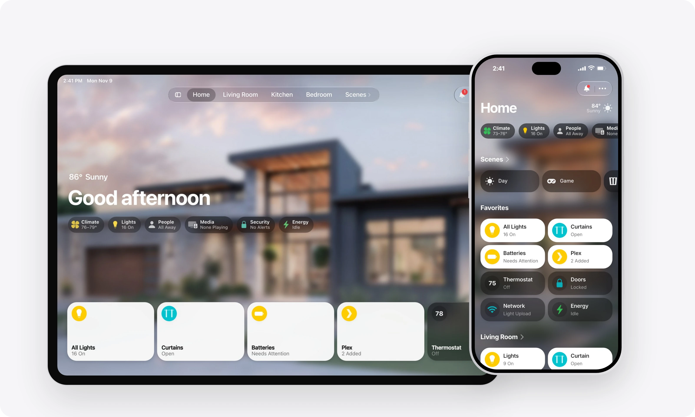
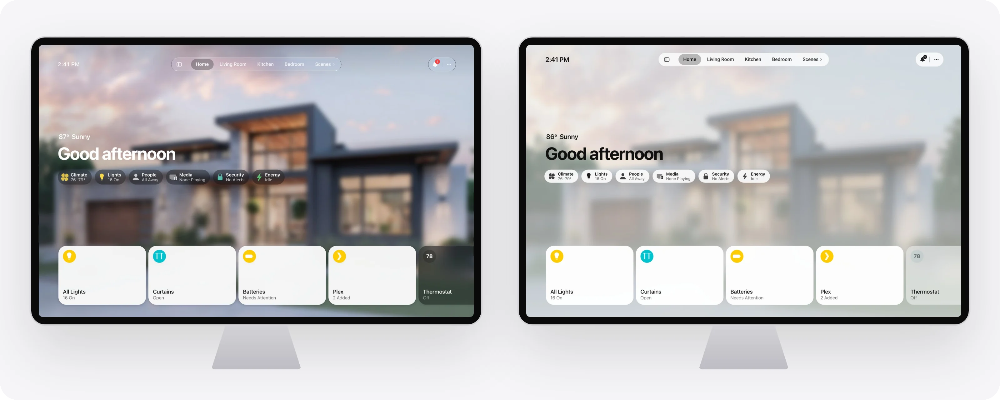
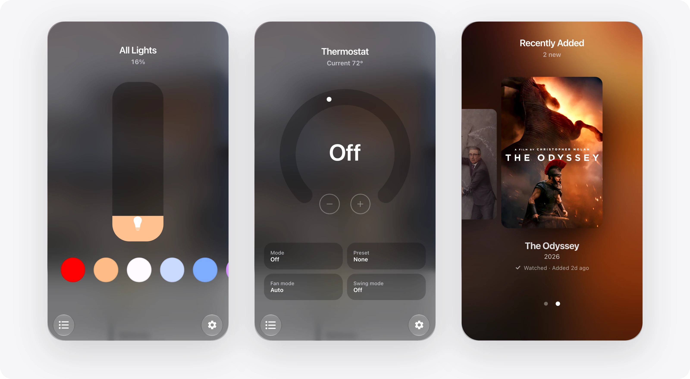
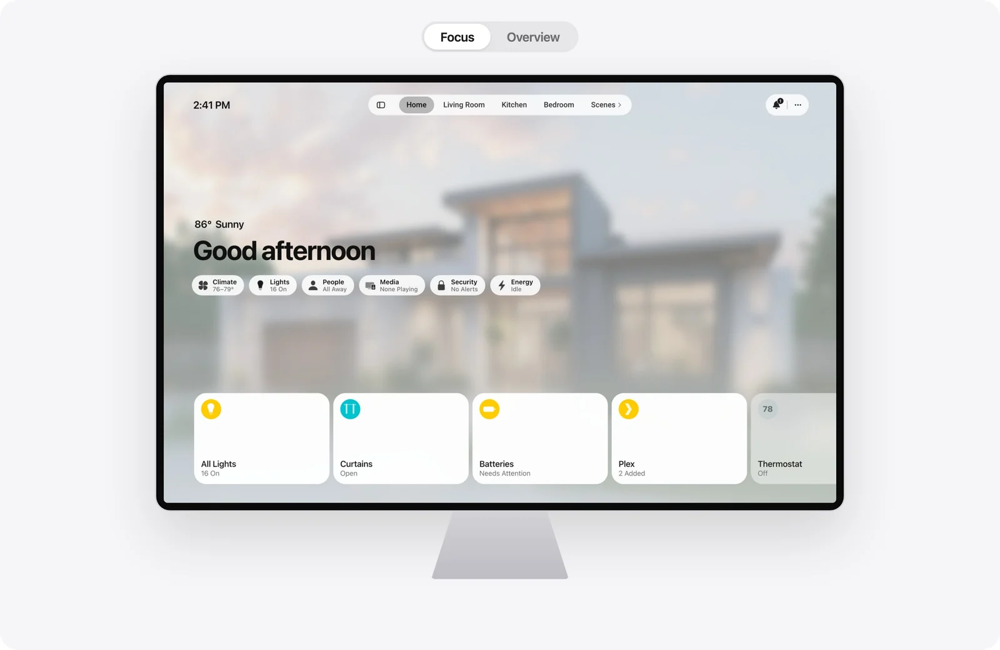
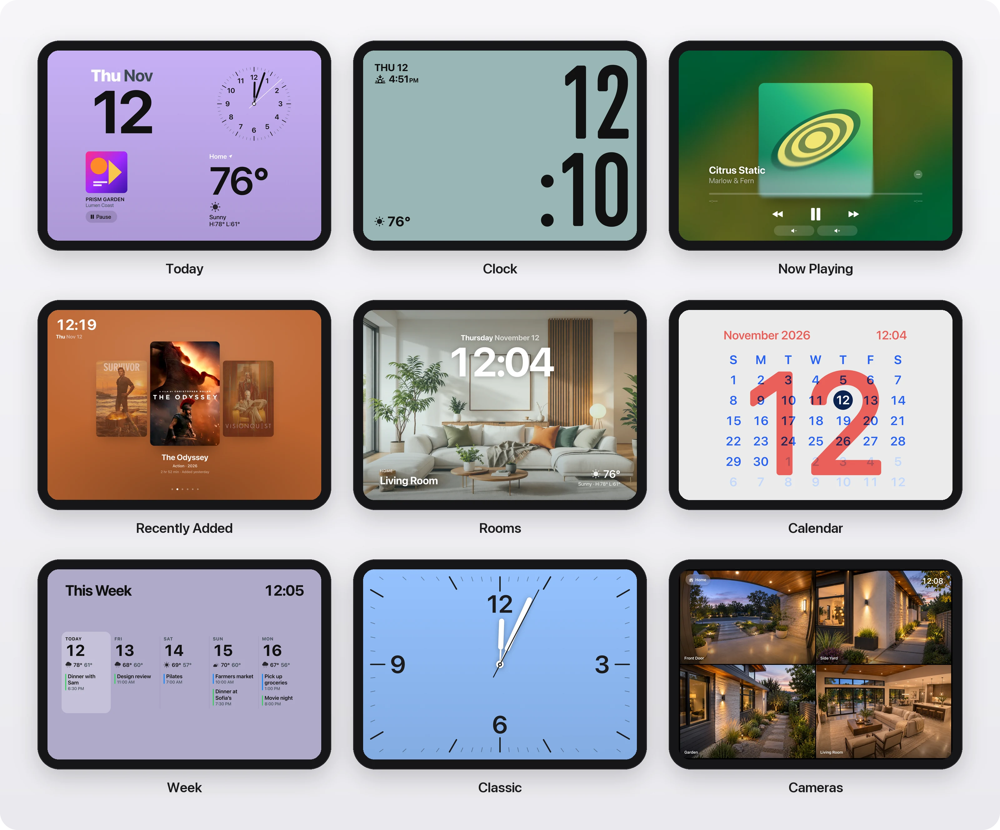
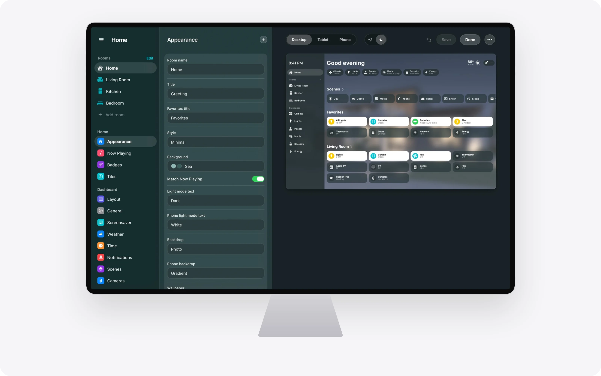

<picture>
  <source media="(prefers-color-scheme: dark)" srcset="docs/images/header-dark.webp" />
  
</picture>

<a href="#install">Install</a>&emsp;<a href="#set-up">Set up</a>&emsp;<a href="#using-it">Using it</a>&emsp;<a href="#studio">Studio</a>&emsp;<a href="CHANGELOG.md">Changelog</a>

 

Hemma turns Home Assistant into a home screen you actually want on the wall. It builds a dashboard for your desktop, wall tablet and phone from the rooms and devices you already have, and **Hemma Studio** in the sidebar lets you shape it with a live preview. No YAML, ever.

  <picture>
    <source media="(prefers-color-scheme: dark)" srcset="docs/images/hero-dark.webp" />
    
  </picture>

## Two styles, light and dark

**Glass** lays frosted tiles over your own room photos. **Minimal** is calm and flat, in a color you pick, with a deeper shade at night. Either one follows light and dark mode on its own, and both can use dark or white text by day.

  <picture>
    <source media="(prefers-color-scheme: dark)" srcset="docs/images/styles-dark.webp" />
    
  </picture>
   Glass on the left, Minimal on the right.

## A popup for every tile

Tap a tile and its popup grows out of it. Each kind of device gets its own, built around the one control you came for.

  <picture>
    <source media="(prefers-color-scheme: dark)" srcset="docs/images/popups-dark.webp" />
    
  </picture>

| Tile | Its popup |
|:--|:--|
| Lights and light groups | A brightness capsule, your favorite colors, and every light in the group |
| Thermostats, fans, purifiers, humidifiers | A dial or slider, with modes as labeled tiles |
| Media and TVs | The artwork, a full-screen player and a remote |
| Locks, covers, vacuums | The state up top, the actions you need below |
| Cameras | A live view and today's motion and doorbell events |
| Energy, network, batteries, updates | Clean charts and lists, the problem first |
| Plants | Today's readings, and an assessment of how the plant is doing |
| Plex | Your newest movies and episodes |

## Focus or Overview

**Focus** gives one room the whole screen, with its photo behind it. **Overview** is a home screen of scenes, favorites and every room, with a sidebar to move between them.

  <picture>
    <source media="(prefers-color-scheme: dark)" srcset="docs/images/layout-dark.webp" />
    
  </picture>

## Screensavers

Brand new screensavers available, perfect for a wall-mounted tablet. **Today** shows the date, the weather and what's playing or your home at a glance, **Clock** fills the screen with a Classic, Numerals or Stacked face, and **Recently Added** shows your newest Plex posters. Each one takes your dashboard's colors, day and night.

  <picture>
    <source media="(prefers-color-scheme: dark)" srcset="docs/images/screensavers-dark.webp" />
    
  </picture>

## Install

Open the link above, or add `https://github.com/willsanderson/Hemma` as a custom repository under **Settings > Marketplace** (called HACS before Home Assistant 2026.11). Download **Hemma**, plus **[UI eXtension](https://github.com/Lint-Free-Technology/uix)** and **[button-card](https://github.com/custom-cards/button-card)** 7.0.0 or newer if you don't have them, then restart Home Assistant.

You need **Home Assistant 2026.9** or newer. Use UI eXtension instead of card-mod, not both.

## Set up

1. **Add the integration** under **Settings > Devices & services > Add integration > Hemma**.
2. **Open Hemma Studio** in the sidebar. It checks that UI eXtension and button-card are ready and links you to anything missing.
3. **Follow the setup assistant.** Pick a layout and a style, then your rooms. Your Home Assistant areas are the starting point, each area's devices land in its room, and a preview shows every tile before anything is created.

Hemma creates its own helpers, registers its resources and selects its theme, unless you already use one of your own. Nothing is written to `configuration.yaml`, updates reach your dashboards on their own, and if something ever goes missing, Studio offers to repair it.

## Using it

| You | Hemma |
|:--|:--|
| Tap a tile | Opens its popup |
| Tap a badge | Opens that category with its tiles from every room |
| Open the sidebar or the tab bar | Moves between rooms, categories and Home |
| Open the bell | Shows what needs you: arrivals, doorbells, open doors, low batteries and updates |
| Leave a wall tablet alone | Starts a screensaver in your dashboard's colors |

On a phone, badges filter the page and each room opens as its own sheet.

## Studio

Rooms, tiles, badges, scenes, cameras, weather and screensavers, all in one place, with a live preview for desktop, tablet and phone, light and dark.

  <picture>
    <source media="(prefers-color-scheme: dark)" srcset="docs/images/studio-dark.webp" />
    
  </picture>

- **Nothing changes until you press Save.** The preview shows every edit first.
- **Separate phone choices.** The phone can have its own backdrop and text color.
- **Export and import.** Save your dashboard to a file and bring it back, on the same Home Assistant or another one.
- **Choose what a tap does,** per tile: Normal, Ask First, or View Only for a tablet you hand to a guest.

## Your data

- **Everything stays home.** Hemma runs inside Home Assistant, with no account, no analytics and no telemetry.
- **AI only when you ask.** The plant assessment runs when you tap Check Now, on the AI task you set up in Home Assistant, and stays hidden if you don't have one.
- **Online only for logos.** Integration logos come from `brands.home-assistant.io`; everything else is served by your own Home Assistant.

Everything Hemma does

 

- **Badges** for climate, lights, people, media, security and energy, plus **status badges** for any device, like a washer with 12 min left.
- **Popups for every tile:** lights, climate, fans and air purifiers, humidifiers, locks, covers, vacuums, media with a TV remote, cameras, energy, network, plants, batteries, updates and Plex.
- **Now Playing** with artwork and controls, and a full-screen player. Understands media players, Plex and Tautulli, Discord, Steam and PlayStation.
- **Cameras** on Home, in rooms and on the Security page, with a timeline of today's motion and doorbell events.
- **Energy** with today's total, usage by device, and Day, Week and Month.
- **A plant assistant** that checks a plant's last week of readings against its needs and tells you what to do, using Home Assistant's AI Task when you have one set up.
- **Screensavers** for wall tablets: Today (date, clock, weather and calendar), Clock, and Recently Added from Plex.
- **Your choice of what a tap does** on each tile: Normal, Ask First, or View Only for a tablet you hand to a guest.
- **Your language.** Hemma follows your Home Assistant language and number formats.

Upgrading from 2.3

 

Update Hemma in the Marketplace and restart Home Assistant. Your dashboards pick up the new templates automatically, so there is nothing to save.

Hemma 2.4 creates its helpers itself. If you copied `packages/hemma_helpers.yaml` for 2.3, Hemma takes those helpers over and you can remove the file and the `packages:` line whenever you like. The `frontend: themes:` line is no longer needed either.

To try the new style, choose **Minimal** under Appearance > Style in Studio.

Coming from Hemma 2.0 (YAML)

 

Open Studio and choose **Import from YAML**. Hemma reads your rooms, entities and badges, shows you what it found, and creates a **new** dashboard next to your original, so you can compare the two before switching.

Translating Hemma

 

Hemma's text lives in one file per language in `custom_components/hemma/translations/dashboard/`. Copy `en.json` to your language code (like `de.json`) and change only the text on the right. Keep the name on the left, anything in braces like `{n}`, and any `%` signs. Lines starting with `studio.` are Hemma Studio; the rest is the dashboard. Anything you leave out shows in English.

`python3 tools/i18ncheck.py --missing de` lists what a language still needs. To share a translation, open a pull request with your file.

Writing your own YAML

 

Hemma builds ordinary dashboards, so custom templates, hand-built views and per-card overrides keep working. See **[docs/ADVANCED.md](docs/ADVANCED.md)** for the folder layout, template variables and the card reference.

## Credits

- **[Homio](https://github.com/iamtherufus/Homio)** by [@iamtherufus](https://github.com/iamtherufus), the original concept and base implementation.
- **[@SH1FT-W](https://github.com/SH1FT-W)**, for finding and fixing more of Hemma's rough edges than anyone, and for [Casora](https://github.com/SH1FT-W/casora), whose ideas several 2.4 features build on.
- Built and maintained by [@willsanderson](https://github.com/willsanderson).

[MIT](LICENSE)

#### Enjoying Hemma?

Hemma is an independent project and is not affiliated with Home Assistant or Nabu Casa.
